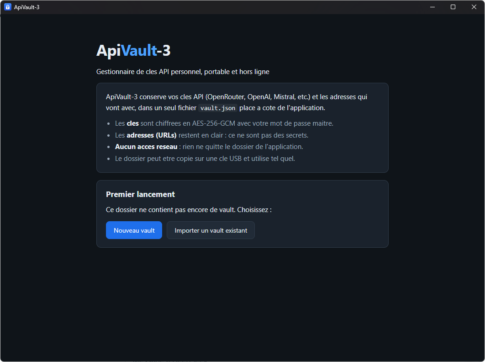
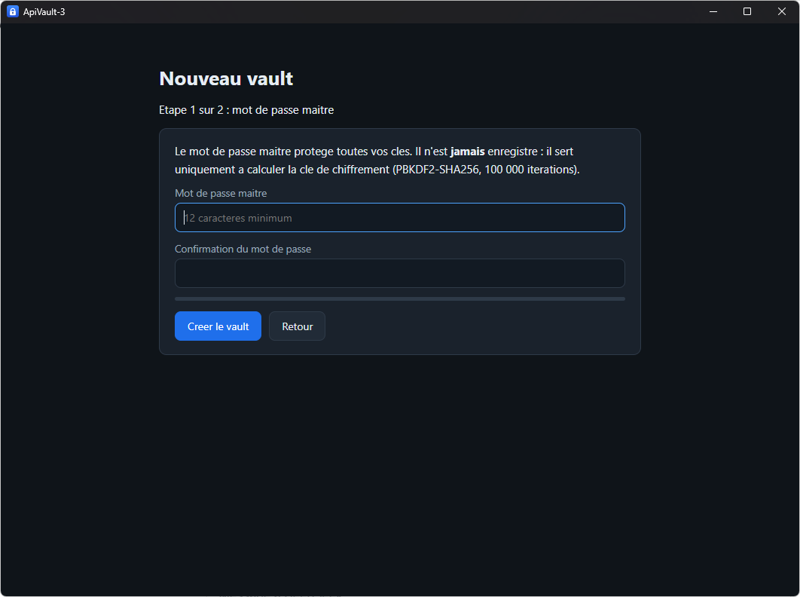
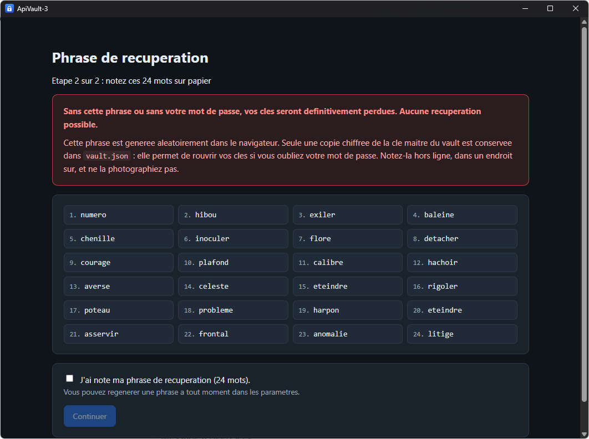
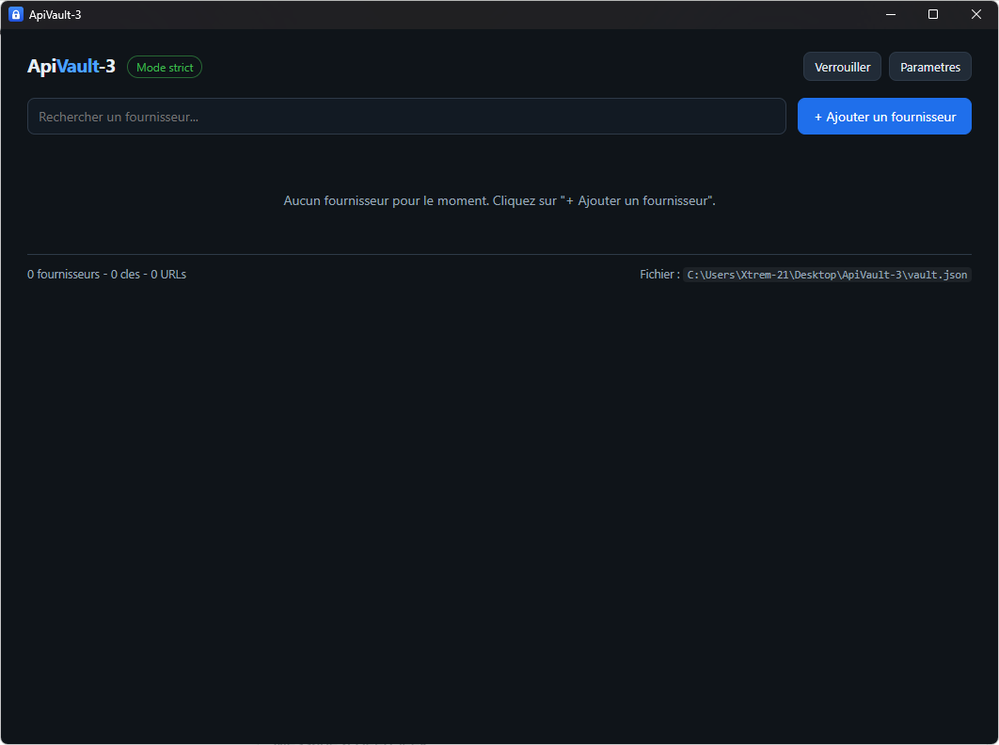
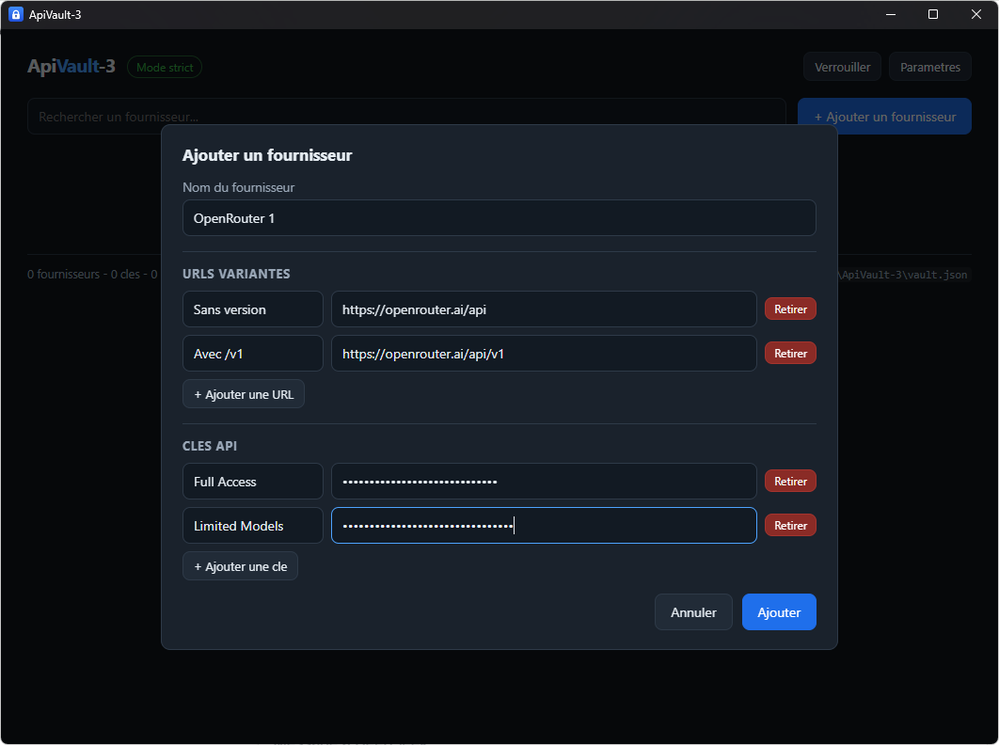
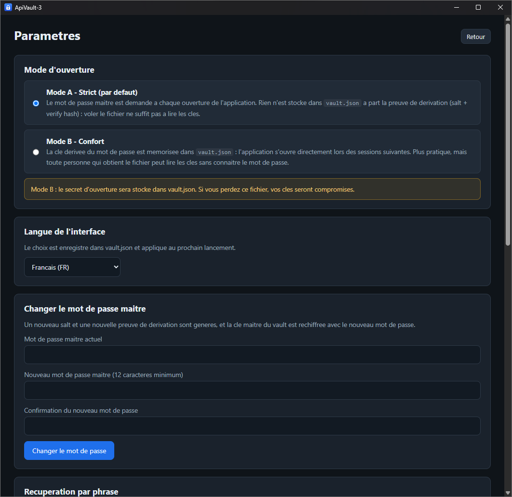
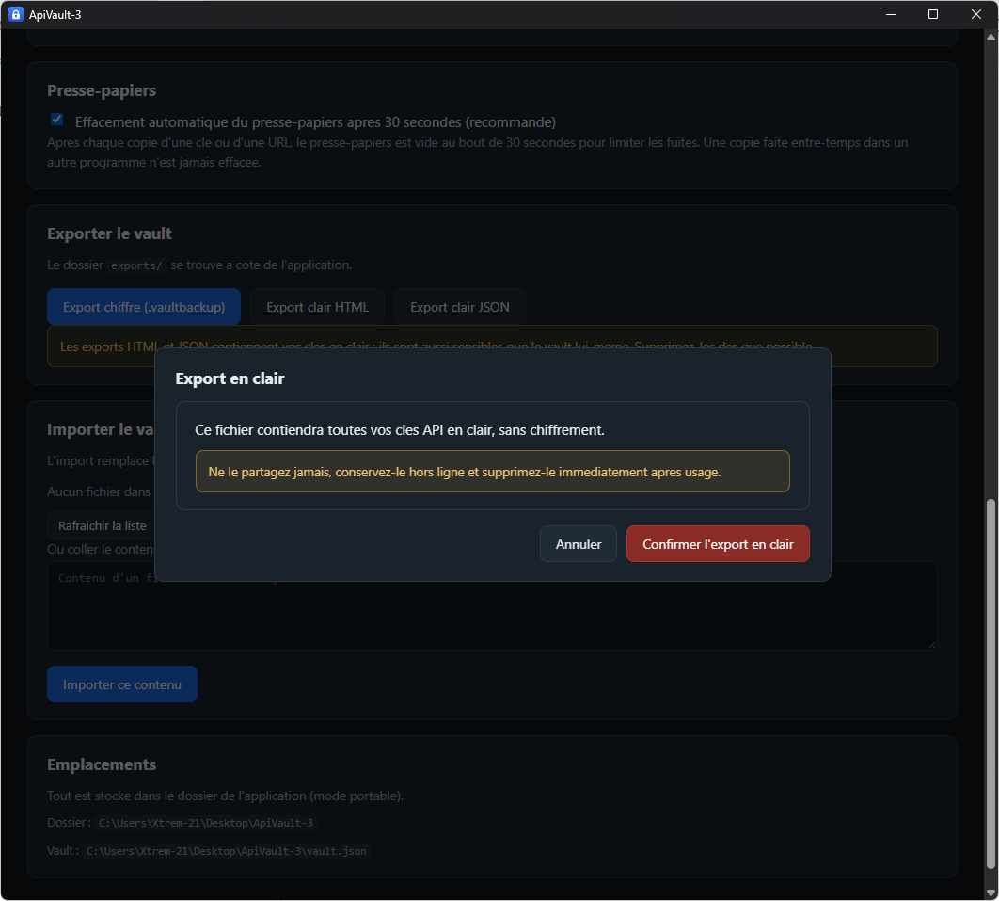
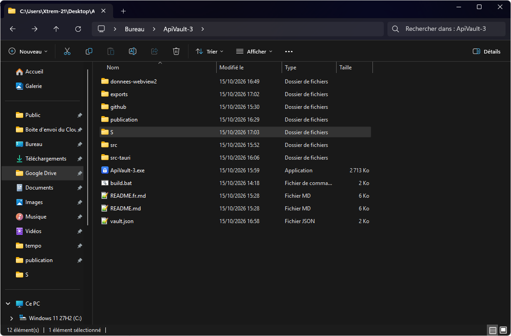

# ApiVault-3

**Un gestionnaire de clés API personnel, portable et entièrement hors ligne pour Windows.**
Construit avec [Tauri v2](https://v2.tauri.app/) (Rust) et du HTML/CSS/JavaScript pur.

ApiVault-3 conserve vos clés API (OpenRouter, OpenAI, Mistral, etc.) ainsi que les
différentes variantes d'URL de chaque fournisseur, dans un unique fichier
`vault.json` placé à côté de l'exécutable. Les clés sont chiffrées en
AES-256-GCM avec un mot de passe maître que vous choisissez ; les URLs restent
en clair car ce ne sont pas des secrets. Le tout tient dans un dossier que vous
pouvez copier sur une clé USB : aucune installation, aucune inscription au
registre, rien d'écrit en dehors de ce dossier, et aucun accès réseau.

---

## Sommaire

- [Captures d'écran](#captures-décran)
- [Fonctionnalités](#fonctionnalités)
- [La sécurité en un coup d'œil](#la-sécurité-en-un-coup-dœil)
- [Prérequis](#prérequis)
- [Téléchargement](#téléchargement)
- [Construire depuis les sources](#construire-depuis-les-sources)
- [Utilisation](#utilisation)
- [Le format de `vault.json`](#le-format-de-vaultjson)
- [Structure du projet](#structure-du-projet)
- [Limites connues](#limites-connues)
- [Documentation](#documentation)
- [Contribuer](#contribuer)
- [Sécurité](#sécurité)
- [Licence](#licence)

---

## Captures d'écran

| Écran de bienvenue | Mot de passe maître |
| --- | --- |
|  |  |

| Phrase de récupération | Écran principal (vault vide) |
| --- | --- |
|  |  |

| Écran principal avec un fournisseur | Paramètres |
| --- | --- |
|  |  |

| Avertissement d'export en clair | Dossier portable |
| --- | --- |
|  |  |

Les captures ne font pas partie du dépôt par défaut ; voir
[`screenshots/README.md`](screenshots/README.md) pour la liste des images à
ajouter et la façon de les nommer.

---

## Fonctionnalités

**Clés et URLs**

- Fournisseurs triés alphabétiquement, avec une barre de recherche.
- Chaque fournisseur contient plusieurs **URLs variantes** : un libellé court
  (« Sans version », « Avec /v1 », « Endpoint embeddings ») et l'adresse
  complète, chacune avec un bouton **Copier** qui copie l'URL telle quelle.
- Chaque fournisseur contient plusieurs **clés API** : un libellé court
  (« Full Access », « Limited Models »), la valeur chiffrée, un bouton
  **Révéler** et un bouton **Copier**.
- Les noms de fournisseurs sont **uniques** : créer un doublon est refusé et un
  nom libre est proposé automatiquement (« OpenRouter 2 »).
- Ajout, modification et suppression des fournisseurs et des clés, avec leur
  date d'ajout (`JJ/MM/AAAA`).

**Sécurité**

- AES-256-GCM, **une IV aléatoire de 12 octets par clé**.
- PBKDF2-SHA256, **100 000 itérations**, sel aléatoire de 16 octets.
- Le mot de passe maître n'est **jamais enregistré** — seule une preuve de
  dérivation l'est.
- Une **clé maître du vault** aléatoire de 32 octets chiffre les clés API : un
  changement de mot de passe n'oblige donc pas à rechiffrer chaque clé.
- **Phrase de récupération de 24 mots** permettant de rouvrir le vault si le mot
  de passe maître est perdu. La phrase elle-même n'est jamais enregistrée.
- Effacement automatique du presse-papiers au bout de 30 secondes (optionnel),
  via l'API Windows du presse-papiers : cela fonctionne même quand la fenêtre est
  en arrière-plan.
- Les valeurs révélées se remasquent automatiquement au bout de 30 secondes.
- Aucun accès réseau, aucune télémétrie, rien d'écrit en dehors du dossier de
  l'application.

**Portabilité**

- Un seul `.exe` (environ 2,7 Mo) accompagné d'un fichier `vault.json`.
- Copiez le dossier sur une clé USB, lancez `ApiVault-3.exe` n'importe où.
- Le profil du navigateur embarqué (WebView2) est redirigé vers
  `donnees-webview2/` dans le dossier : aucune donnée n'atterrit dans `%APPDATA%`
  ni dans `%LOCALAPPDATA%`.

**Modes d'ouverture**

- **Mode A - Strict (par défaut)** : le mot de passe maître est demandé à chaque
  lancement.
- **Mode B - Confort** : la clé dérivée est mémorisée dans `vault.json` et
  l'application s'ouvre directement. Plus pratique, mais toute personne qui
  obtient le fichier peut lire les clés.

**Interface bilingue**

- Français et anglais, détectés depuis la langue du système et modifiables dans
  les paramètres ; le choix est enregistré dans `vault.json`.

**Import / export**

- Sauvegarde chiffrée `.vaultbackup` (restaurable avec le mot de passe maître).
- Export en clair : page HTML lisible (tableaux) et JSON, tous deux protégés par
  un avertissement rouge et une confirmation explicite.
- Import depuis un `.vaultbackup`, un export JSON en clair ou un `vault.json`
  brut, soit depuis le sous-dossier `exports/`, soit en collant le contenu.

---

## La sécurité en un coup d'œil

| Élément | Où il se trouve |
| --- | --- |
| Clés API | `vault.json`, **chiffrées** (AES-256-GCM, une IV par clé) |
| URLs variantes | `vault.json`, **en clair** (ce ne sont pas des secrets) |
| Mot de passe maître | **jamais écrit sur le disque** |
| Preuve de dérivation | `kdf.verify_hash` (PBKDF2-SHA256, 100 000 itérations) |
| Clé maître du vault | `kdf.cle_maitre_chiffree` (emballée par la clé du mot de passe) et `recuperation.cle_maitre_chiffree` (emballée par la clé de la phrase) |
| Phrase de récupération | **jamais écrite sur le disque** |
| Réseau | **aucun** |

Détails techniques complets : [`docs/SECURITY.md`](docs/SECURITY.md).

---

## Prérequis

**Pour utiliser** (depuis une version publiée, ou votre propre compilation) :

| Composant | Remarques |
| --- | --- |
| Windows 10 ou 11 | |
| Microsoft Edge WebView2 Runtime | Déjà présent sur Windows 11 et sur la plupart des installations Windows 10. S'il manque, installez-le une fois depuis <https://developer.microsoft.com/microsoft-edge/webview2/>. |

**Pour construire depuis les sources**, en plus :

| Composant | Remarques |
| --- | --- |
| Rust (cargo, rustc) | <https://rustup.rs> — toolchain stable, cible MSVC |
| Tauri CLI v2 | `cargo install tauri-cli --version "^2"` |
| Visual Studio Build Tools | charge de travail « Développement Desktop en C++ » (éditeur de liens MSVC) |

Node.js et npm ne sont pas nécessaires : le frontend est constitué de fichiers
statiques que Tauri embarque dans l'exécutable.

---

## Téléchargement

Récupérez `apivault-3.exe` dans la [dernière version publiée](../../releases/latest),
placez-le dans un dossier vide et renommez-le comme vous voulez (par exemple
`ApiVault-3.exe`). Au premier lancement, il crée `vault.json` à côté de lui.

> L'exécutable n'est pas signé numériquement : Windows SmartScreen peut afficher
> un avertissement la première fois. Vous pouvez aussi le compiler vous-même avec
> `build.bat`.

---

## Construire depuis les sources

Clonez le dépôt et double-cliquez sur **`build.bat`**, ou depuis un terminal :

```bat
build.bat
```

Le script compile l'application puis copie l'exécutable produit vers
`ApiVault-3.exe` à la racine du projet. Sortie attendue :

```
Termine : ApiVault-3.exe est pret a la racine du dossier.
```

Équivalent manuel :

```bat
cd src-tauri
cargo tauri build
copy /Y "target\release\apivault-3.exe" "..\ApiVault-3.exe"
```

La première compilation prend environ cinq minutes (tout l'écosystème Tauri est
compilé) ; les suivantes prennent environ une minute et demie.

Plus de détails (y compris le workflow GitHub Actions) :
[`docs/BUILD.md`](docs/BUILD.md).

---

## Utilisation

1. Double-cliquez sur `ApiVault-3.exe`.
2. Au premier lancement, choisissez **Nouveau vault**, définissez un mot de passe
   maître (12 caractères minimum), puis notez la **phrase de récupération de
   24 mots** et cochez la case.
3. Cliquez sur **+ Ajouter un fournisseur**, puis renseignez :
   - le nom du fournisseur (unique),
   - ses **URLs variantes** (libellé court + adresse complète),
   - ses **clés API** (libellé court + valeur).
4. Utilisez **Révéler** pour afficher une clé et **Copier** pour la placer (ou
   placer une URL) dans le presse-papiers.
5. Cliquez sur **Verrouiller** quand vous avez terminé, ou fermez simplement la
   fenêtre.

Guide pas à pas de chaque écran : [`docs/USAGE.md`](docs/USAGE.md).

---

## Le format de `vault.json`

```json
{
  "version": 2,
  "mode": "strict",
  "kdf": {
    "salt": "<base64, 16 octets>",
    "iterations": 100000,
    "verify_hash": "<base64>",
    "iv_cle_maitre": "<base64, 12 octets>",
    "cle_maitre_chiffree": "<base64>"
  },
  "parametres": {
    "effacement_presse_papiers": true,
    "langue": "fr"
  },
  "fournisseurs": [
    {
      "id": "uuid",
      "nom": "OpenRouter 1",
      "urls": [
        { "libelle": "Sans version", "adresse": "https://openrouter.ai/api" },
        { "libelle": "Avec /v1", "adresse": "https://openrouter.ai/api/v1" }
      ],
      "cles": [
        {
          "libelle": "Full Access",
          "iv": "<base64, 12 octets>",
          "valeur_chiffree": "<base64>",
          "date_ajout": "15/10/2026"
        }
      ]
    }
  ],
  "recuperation": {
    "sel_phrase": "<base64, 16 octets>",
    "iterations": 100000,
    "iv": "<base64, 12 octets>",
    "cle_maitre_chiffree": "<base64>"
  }
}
```

- Les clés sont chiffrées, les URLs ne le sont pas.
- `recuperation` est absent lorsque la récupération par phrase n'est pas activée.
- `mode` vaut `strict` ou `confort` ; en `confort`, `kdf.cle_memorisee` contient
  la clé d'ouverture dérivée.
- Les noms de champs sont en français : le format a été défini ainsi dans la
  spécification d'origine et il est conservé pour la compatibilité.

Les vaults écrits par les versions précédentes (`version: 1`, clés chiffrées
directement avec la clé dérivée du mot de passe, pas de `kdf.iv_cle_maitre` ni de
`recuperation`) restent pris en charge. **Paramètres → Récupération par phrase →
Activer la récupération par phrase** fait passer un tel vault en version 2.

---

## Structure du projet

```
.
├── build.bat              Script de construction (cargo tauri build + copie)
├── README.md              Version anglaise
├── README.fr.md           Ce fichier
├── LICENSE                MIT
├── src/                   Frontend (HTML/CSS/JS pur)
│   ├── index.html
│   ├── style.css
│   ├── app.js             Logique de l'interface, modèle du vault, exports/imports
│   ├── crypto.js          PBKDF2, AES-256-GCM, clé maître, récupération
│   ├── bip39.js           Génération et validation de la phrase de récupération
│   ├── i18n.js            Moteur de traduction
│   └── i18n/{fr,en}.json  Dictionnaires de traduction
├── src-tauri/             Partie Rust (Tauri)
│   ├── Cargo.toml
│   ├── tauri.conf.json
│   ├── capabilities/default.json
│   ├── icons/
│   └── src/main.rs        Point d'entrée, commandes fichiers et presse-papiers
├── docs/                  Architecture, sécurité, construction, utilisation
├── screenshots/           Captures utilisées par ce README
└── .github/workflows/     Workflow de construction GitHub Actions
```

Plus de détails : [`docs/ARCHITECTURE.md`](docs/ARCHITECTURE.md).

---

## Limites connues

- **Non signé numériquement** : Windows SmartScreen peut afficher un
  avertissement au premier lancement.
- **Windows uniquement** pour l'instant : l'assistant presse-papiers appelle
  l'API Win32. Le frontend et la couche cryptographique sont indépendants de la
  plateforme, donc le portage consiste surtout à remplacer cet assistant.
- **Aucune protection mono-instance** : deux copies lancées en même temps
  écrivent toutes les deux `vault.json` ; le dernier écrivain gagne.
- **Les clés sont en mémoire pendant que le vault est ouvert** : un logiciel
  malveillant actif sur la machine à ce moment-là peut les lire.
- **Les exports en clair sont dangereux par nature** : ils contiennent les clés
  sans chiffrement. Ils sont écrits dans `exports/` et doivent être supprimés
  après usage.
- **En mode B, `vault.json` suffit à tout lire** — c'est le compromis assumé de
  ne pas saisir le mot de passe.

---

## Documentation

| Document | Contenu |
| --- | --- |
| [docs/USAGE.md](docs/USAGE.md) | Guide d'utilisation détaillé |
| [docs/ARCHITECTURE.md](docs/ARCHITECTURE.md) | Comment les pièces s'articulent |
| [docs/SECURITY.md](docs/SECURITY.md) | Détails cryptographiques et modèle de menace |
| [docs/BUILD.md](docs/BUILD.md) | Construction depuis les sources, CI, dépannage |
| [CHANGELOG.md](CHANGELOG.md) | Historique des versions |

---

## Contribuer

Les pull requests sont bienvenues. Lisez d'abord
[CONTRIBUTING.md](CONTRIBUTING.md) : il est court et couvre le nommage des
branches, la règle « aucun texte en dur dans l'interface » et l'esprit « aucune
nouvelle dépendance » du projet. Tous les participants sont invités à respecter
le [Code de conduite](CODE_OF_CONDUCT.md).

---

## Sécurité

Merci de signaler les vulnérabilités en privé — voir [SECURITY.md](SECURITY.md).
N'ouvrez jamais une issue publique contenant une vraie clé, un mot de passe ou un
`vault.json`.

---

## Licence

[MIT](LICENSE) — Copyright (c) 2026 ApiVault contributors.
